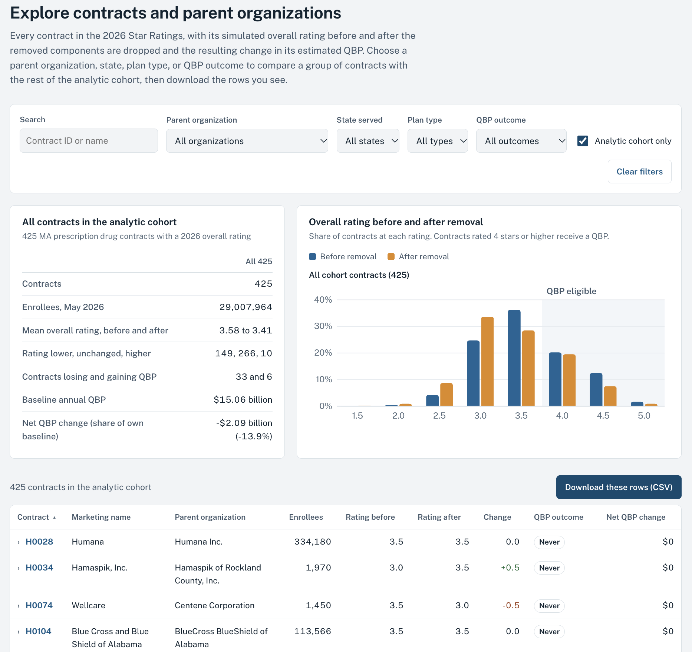

# Characteristics and Financial Implications of Measures Removed From Medicare Advantage Star Ratings

**View the results without code: [interactive summary and contract explorer](https://derektlakephd-prog.github.io/ma-star-ratings-2026/)**

Derek T. Lake, PhD, Center for Value-Based Care Research, Cleveland Clinic

Analytic code, derived data, and documentation for the following Research Letter:

> Lake DT, Civelek Y, Bond AM, Khullar D. Characteristics and financial implications of measures removed from Medicare Advantage star ratings. *JAMA Netw Open*. 2026;9(10):e2640240. doi:[10.1001/jamanetworkopen.2026.40240](https://doi.org/10.1001/jamanetworkopen.2026.40240)

Please cite the article above, not this repository, in any work that uses the code, the derived data, or the results. The "Cite this repository" button on GitHub returns the article citation.

```bibtex
@article{Lake2026StarRatings,
  author  = {Lake, Derek T. and Civelek, Yasin and Bond, Amelia M. and Khullar, Dhruv},
  title   = {Characteristics and Financial Implications of Measures Removed From Medicare Advantage Star Ratings},
  journal = {JAMA Network Open},
  year    = {2026},
  volume  = {9},
  number  = {10},
  pages   = {e2640240},
  doi     = {10.1001/jamanetworkopen.2026.40240}
}
```

## Overview

In April 2026, the Centers for Medicare & Medicaid Services (CMS) finalized a rule removing 11 measures from the Medicare Advantage (MA) Star Ratings, citing, among other reasons, consistently high performance and limited variation across contracts. Two of the measures have separate Part C and Part D components, so 13 measure components leave the rating algorithm.

The Research Letter addresses two questions.

1. Whether the removed measures were topped out. Each measure's raw contract-level performance rate is placed on a 0 to 100 attainment scale, and a measure is classified as topped out when its bottom-decile (10th percentile) contract reaches at least 90. The criterion follows the retirement of a beta-blocker quality measure once even bottom-decile performers exceeded 90% (Lee TH, *N Engl J Med*, 2007).
2. The effect of removal on quality bonus payments (QBPs). The analysis replicates the 2026 Star Ratings with and without the removed measures and prices the change in QBP eligibility using county benchmark rates and May 2026 enrollment.

Five of the 13 removed components (38%) were topped out, compared with none of the 30 retained measures. In simulation, 33 contracts lose QBP eligibility and 6 gain it, for a net reduction of $2.09 billion in annual 2026 QBPs, 13.9% of the baseline pool.

## Contract explorer

An interactive page at **https://derektlakephd-prog.github.io/ma-star-ratings-2026/** shows each of the 720 MA contracts in the 2026 Star Ratings with its simulated overall rating before and after removal and the change in its estimated QBP. Filter by parent organization, state, plan type, or QBP outcome, compare the selection with the rest of the analytic cohort, open any contract for its Part C, Part D, and removed-measure stars, and download the filtered rows as CSV. The page reads `data/derived/contract_level_results.csv` and the public CMS files through `site/build_explorer_data.py`; it can also be opened locally from `index.html` without a server.



## Repository contents

| Path | Contents |
|---|---|
| `notebooks/01_star_rating_simulation.ipynb` | Replicates the 2026 CMS Star Ratings, recomputes ratings after removing the 13 components, prices QBP eligibility, and builds the analytic cohort |
| `notebooks/02_measures_figure_table.ipynb` | Cohort characteristics, attainment scale, topped-out classification, sensitivity analysis, Figure, Table, and a check of every number reported in the article |
| `data/raw/` | Public CMS input files, unchanged (two enrollment files are compressed) |
| `data/derived/` | Files written by the notebooks, including the contract-level results |
| `outputs/` | Figure, Table, topped-out classification, sensitivity grid, and the values quoted in the Results |
| `docs/data_dictionary.md` | Every derived file and variable |
| `docs/measures.md` | Reference table for the 45 Star Ratings measures |
| `docs/glossary.md` | Terms used in the code and documentation |
| `docs/methods_sources.md` | The CMS document, regulation, or publication behind each computational step |
| `data/README.md` | Source, release, and checksum for each input file |
| `index.html`, `site/` | Contract explorer page, its data file (`site/explorer_data.js`), the script that builds it, and the page's font files |

## Data

All inputs are public files released by CMS: the 2026 Star Ratings Data Tables (October 8, 2025 release), the 2025 Star Ratings Summary Ratings table (used only for a diagnostic of disaster-affected contracts), the May 2026 Monthly MA Enrollment by State/County/Contract file, the May 2026 Monthly Enrollment by Contract/Plan/State/County files, and the 2026 MA ratebook. `data/README.md` lists the source page, release, and SHA-256 checksum of each file. CMS revises and retires files over time, so the exact versions used are included in `data/raw`.

## Reproducing the results

The analysis was run with Python 3.13.2, pandas 2.2.3, NumPy 2.2.4, and Matplotlib 3.10.1. openpyxl reads the ratebook workbook.

```
git clone https://github.com/derektlakephd-prog/ma-star-ratings-2026.git
cd ma-star-ratings-2026
python3 -m venv .venv
source .venv/bin/activate          # Windows: .venv\Scripts\activate
pip install -r requirements.txt
```

Run notebook 01 and then notebook 02, either in JupyterLab (`jupyter lab`, then Kernel > Restart Kernel and Run All Cells) or from the command line:

```
jupyter nbconvert --to notebook --execute --inplace notebooks/01_star_rating_simulation.ipynb
jupyter nbconvert --to notebook --execute --inplace notebooks/02_measures_figure_table.ipynb
```

To rebuild the explorer data after running the notebooks, run `python site/build_explorer_data.py` from the repository root.

The two notebooks take about two minutes in total. Each ends with assertions that restate the numbers reported in the article; the final cell of notebook 02 checks 40 of them and stops at the first value that does not reproduce. Its last check confirms the package versions reported in the article, so it fails under other versions even when every result reproduces; install from `requirements.txt` to match them. The notebooks are committed with their outputs, so the results can be read without running anything. The Figure uses Arial when it is installed and a similar sans serif font otherwise; the content is the same.

## Outputs and the article

| Article element | File | Produced in |
|---|---|---|
| Figure | `outputs/figure_dot_plot.pdf`, `outputs/figure_dot_plot.png` | Notebook 02, section 7 |
| Table | `outputs/table_qbp_transitions_formatted.csv`, `outputs/table_qbp_transitions_formatted.md`; unrounded values in `outputs/table_qbp_transitions.csv` | Notebook 02, section 8 |
| Results text | `outputs/results_text_values.csv` | Notebook 02, sections 2 and 6 |
| Topped-out classification (Results; eMethods, Topped-Out Definition) | `outputs/topped_out_classification.csv` | Notebook 02, section 4 |
| Sensitivity analysis (eMethods, Topped-Out Definition) | `outputs/sensitivity_thresholds.csv` | Notebook 02, section 5 |
| Sample exclusions (eMethods, Sample Exclusions) | `data/derived/sample_construction.csv` | Notebook 01, section 8 |
| Replication accuracy (eMethods, Replication Accuracy) | `Replication_Match` in `data/derived/contract_level_results.csv` | Notebook 01, section 4 |
| Reward factor recalibration (eMethods, Reward Factor Recalibration) | `data/derived/reward_factor_thresholds.csv` | Notebook 01, section 6 |
| Disaster mismatch diagnostic (eMethods, Data Sources) | `data/derived/disaster_mismatch_diagnostic.csv` | Notebook 01, section 5 |
| QBP estimates (eMethods, Quality Bonus Payment Calculation) | `data/derived/contract_level_results.csv` | Notebook 01, section 7 |

## License and permissions

- Code in `notebooks/`, `site/build_explorer_data.py`, and the scripts in `index.html` is licensed under the Apache License, Version 2.0 (`LICENSE`). Redistributions must carry the `NOTICE` file, which includes the article citation.
- Derived data in `data/derived/`, outputs in `outputs/`, and documentation in `docs/` and in this file are licensed under the Creative Commons Attribution 4.0 International License (`LICENSE-DATA`). Attribution should take the form of a citation to the article.
- The article itself, including its text, Figure, and Table as published, is distributed by *JAMA Network Open* under the CC BY-NC-ND 4.0 license stated in the article.
- Files in `data/raw/` are works of the US government, are in the public domain, and are redistributed unchanged.
- The Public Sans font files in `site/fonts/` are distributed under the SIL Open Font License 1.1 (`site/fonts/OFL.txt`).

Copyright 2026 Derek T. Lake. For custom analyses or alternative removal scenarios, contact the author.

## About the author

Derek T. Lake, PhD, is a health economist and health services researcher. He is Associate Staff and Director of Research for Hospital at Home in the Center for Value-Based Care Research at Cleveland Clinic and an Adjunct Research Associate in the Department of Health Services, Policy & Practice at the Brown University School of Public Health. His research examines Medicare Advantage, insurer-provider integration, and the substitution of care across hospital, post-acute, and home settings, using Medicare claims and quasi-experimental methods. He received his PhD in health services research from Brown University.

## Funding

As stated in the article: This work was supported by Arnold Ventures and The Physicians Foundation Center for the Study of Physician Practice and Leadership at Weill Cornell Medicine. The funders had no role in the design and conduct of the study; collection, management, analysis, and interpretation of the data; preparation, review, or approval of the manuscript; and decision to submit the manuscript for publication.

## Disclaimer

The ratings and payments in this repository are simulation estimates. They are not official CMS Star Ratings or payment determinations. CMS did not sponsor, review, or endorse this work.

## Contact

Derek T. Lake, PhD, corresponding author of the article. derek.t.lake.phd@gmail.com. ORCID [0000-0002-6250-8737](https://orcid.org/0000-0002-6250-8737).
